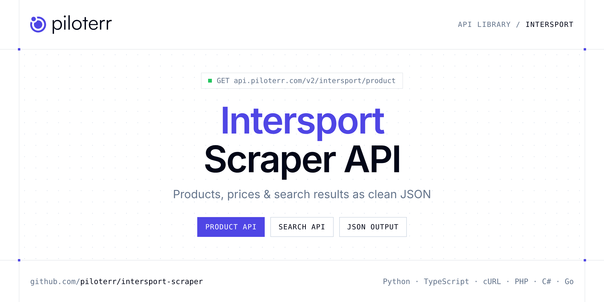

<p align="center">
  <a href="https://www.piloterr.com"></a>
</p>

# Intersport Scraper API

[](https://discord.gg/CFj3ph8aHU) [](https://app.piloterr.com) [](https://app.piloterr.com/openapi) [](LICENSE)

The **Piloterr Intersport Scraper API** lets you extract public data from Intersport as **clean, structured JSON** — no proxies, headless browsers or HTML parsing to maintain. Endpoints available in production:

- **Intersport Product API** — Read one Intersport product from its URL.
- **Intersport Search API** — Search Intersport by keyword and page the sports grid.

Use it for price monitoring, assortment tracking, competitor analysis, product research or catalog enrichment.

| Endpoint | Path | Credits | What you get |
|---|---|---|---|
| [Intersport Product API](#intersport-product-api) | `/v2/intersport/product` | 2 | Read one Intersport product from its URL. You get price, brand, and the product details. |
| [Intersport Search API](#intersport-search-api) | `/v2/intersport/search` | 2 | Search Intersport by keyword and page the sports grid. Cards include title, price, and product link. |

## Table of contents

- [How it works](#how-it-works)
- [Intersport Product API](#intersport-product-api)
- [Intersport Search API](#intersport-search-api)
- [Code examples in other languages](#code-examples-in-other-languages)
- [Practical use cases](#practical-use-cases)
- [Why Piloterr?](#why-piloterr)
- [FAQ](#faq)
- [Official SDKs](#official-sdks)
- [Related scrapers](#related-scrapers)
- [Support](#support)

## How it works

1. **Create a free Piloterr account** and copy your API key from the [dashboard](https://app.piloterr.com).
2. **Send a `GET` (or `POST`) request** to `https://api.piloterr.com/v2/...` with the header `x-api-key: YOUR_API_KEY`.
3. **Receive structured JSON** — Piloterr handles rendering, proxies, retries and parsing.

```bash
export PILOTERR_API_KEY="your-api-key"
pip install requests        # Python
# TypeScript: Node.js 18+ (native fetch), run with `npx tsx file.ts`
```

> Every endpoint accepts both `GET` (query string) and `POST` (JSON body with the same fields).

## Intersport Product API

Read one Intersport product from its URL. You get price, brand, and the product details.

`GET | POST https://api.piloterr.com/v2/intersport/product` · **2 credits per request** · [Full reference](https://app.piloterr.com/openapi)

### Request parameters

| Parameter | Type | Required | Description |
|---|---|---|---|
| `query` | string | ✅ | Product URL on intersport.fr, or a root-relative path ending in -p-{id}. |
| `return_page_source` | boolean | — | When true, returns the raw HTML instead of the parsed JSON. The response shape is {"result": "<html>..."}. Default false. |

### Python example

```python
import json
import os
import requests

response = requests.get(
    "https://api.piloterr.com/v2/intersport/product",
    headers={"x-api-key": os.environ["PILOTERR_API_KEY"]},
    params={
        "query": "https://www.intersport.fr/blancetvert-chaussures_de_running_homme_pegasus_plus2-nike-p-IM2541~VZE/",
    },
    timeout=120,
)
response.raise_for_status()
data = response.json()

print(json.dumps(data, indent=2, ensure_ascii=False)[:2000])
```

### TypeScript example

```typescript
type IntersportProduct = {
  url?: string;
  brand?: string;
  image?: string;
  price?: number;
  sizes?: {
    ean?: string;
    size?: string;
    price?: unknown;
    in_stock?: boolean;
    price_display?: unknown;
  }[];
  title?: string;
  images?: string[];
  category?: string;
  currency?: string;
  product_id?: string;
  description?: string;
  availability?: string;
  price_display?: string;
};

const params = new URLSearchParams({
  "query": "https://www.intersport.fr/blancetvert-chaussures_de_running_homme_pegasus_plus2-nike-p-IM2541~VZE/",
});

const response = await fetch(`https://api.piloterr.com/v2/intersport/product?${params}`, {
  headers: { "x-api-key": process.env.PILOTERR_API_KEY! },
});
if (!response.ok) throw new Error(`Piloterr error ${response.status}: ${await response.text()}`);

const data = (await response.json()) as IntersportProduct;

console.log(JSON.stringify(data, null, 2).slice(0, 2000));
```

<details>
<summary><b>POST variant</b></summary>

```http
POST https://api.piloterr.com/v2/intersport/product
x-api-key: YOUR_API_KEY
Content-Type: application/json

{"query": "https://www.intersport.fr/blancetvert-chaussures_de_running_homme_pegasus_plus2-nike-p-IM2541~VZE/"}
```
</details>

### Output example

Example response from the API reference, abridged — real values depend on the page you scrape.

```json
{
  "url": "https://www.intersport.fr/blancetvert-chaussures_de_running_homme_pegasus_plus2-nike-p-IM2541~VZE/",
  "brand": "NIKE",
  "image": "https://media.intersport.fr/is/image/intersportfr/IM2541_VZE_Q1?$product_grey$&layer=comp&fit=constrain,0&$produit_xl$&fmt=webp",
  "price": 169.99,
  "sizes": [
    {
      "ean": "0198966699953",
      "size": "38,5",
      "price": null,
      "in_stock": false,
      "price_display": null
    },
    {
      "ean": "0198966742147",
      "size": "39",
      "price": null,
      "in_stock": false,
      "price_display": null
    }
  ],
  "title": "Chaussures de running homme Pegasus Plus 2 blanc et vert",
  "images": [
    "https://media.intersport.fr/is/image/intersportfr/IM2541_VZE_Q1?$product_grey$&layer=comp&fit=constrain,0&$produit_xl$&fmt=webp",
    "https://media.intersport.fr/is/image/intersportfr/IM2541_VZE_PR?$product_grey$&layer=comp&fit=constrain,0&$produit_xl$&fmt=webp"
  ],
  "category": "Running > Chaussures > Chaussures homme",
  "currency": "EUR",
  "product_id": "IM2541 VZE",
  "description": "La Pegasus Plus 2 fait passer l'amorti réactif au niveau supérieur. Nike a ajouté une unité Air Zoom incurvée à l'avant-pied pour fournir…",
  "availability": "in_stock",
  "price_display": "169,99 €"
}
```

### Response fields

| Field | Type | Description |
|---|---|---|
| `url` | string |  |
| `brand` | string |  |
| `image` | string |  |
| `price` | number |  |
| `sizes[]` | object[] |  |
| `sizes[].ean` | string |  |
| `sizes[].size` | string |  |
| `sizes[].price` | object |  |
| `sizes[].in_stock` | boolean |  |
| `sizes[].price_display` | object |  |
| `title` | string |  |
| `images` | string[] |  |
| `category` | string |  |
| `currency` | string |  |
| `product_id` | string |  |
| `description` | string |  |
| `availability` | string |  |
| `price_display` | string |  |

## Intersport Search API

Search Intersport by keyword and page the sports grid. Cards include title, price, and product link.

`GET | POST https://api.piloterr.com/v2/intersport/search` · **2 credits per request** · [Full reference](https://app.piloterr.com/openapi)

### Request parameters

| Parameter | Type | Required | Description |
|---|---|---|---|
| `query` | string | ✅ | Keyword or an intersport.fr listing URL. A product URL returns 400. |
| `page` | number | — | Page number, from 1. Default is 1. Intersport's page query is zero-based, so page 2 is sent as page=1. |
| `return_page_source` | boolean | — | When true, returns the raw HTML instead of the parsed JSON. The response shape is {"result": "<html>..."}. Default false. |

### Python example

```python
import json
import os
import requests

response = requests.get(
    "https://api.piloterr.com/v2/intersport/search",
    headers={"x-api-key": os.environ["PILOTERR_API_KEY"]},
    params={
        "query": "nike",
    },
    timeout=120,
)
response.raise_for_status()
data = response.json()

print(json.dumps(data, indent=2, ensure_ascii=False)[:2000])
```

### TypeScript example

```typescript
type IntersportSearch = {
  results?: {
    url?: string;
    brand?: string;
    image?: string;
    price?: number;
    title?: string;
    rating?: number;
    currency?: string;
    position?: number;
    product_id?: string;
    color_count?: number;
    review_count?: number;
    price_display?: string;
  }[];
  pagination?: {
    next?: string;
    page?: number;
    per_page?: number;
    total_pages?: number;
    total_results?: number;
  };
};

const params = new URLSearchParams({
  "query": "nike",
});

const response = await fetch(`https://api.piloterr.com/v2/intersport/search?${params}`, {
  headers: { "x-api-key": process.env.PILOTERR_API_KEY! },
});
if (!response.ok) throw new Error(`Piloterr error ${response.status}: ${await response.text()}`);

const data = (await response.json()) as IntersportSearch;

console.log(JSON.stringify(data, null, 2).slice(0, 2000));
```

<details>
<summary><b>POST variant</b></summary>

```http
POST https://api.piloterr.com/v2/intersport/search
x-api-key: YOUR_API_KEY
Content-Type: application/json

{"query": "nike"}
```
</details>

### Output example

Example response from the API reference, abridged — real values depend on the page you scrape.

```json
{
  "results": [
    {
      "url": "https://www.intersport.fr/bleu_marine-maillot_de_football_enfant_equipe_de_francestadium_domicile_26-nike-p-IB5129~6Y9/",
      "brand": "NIKE",
      "image": "https://media.intersport.fr/is/image/intersportfr/IB5129_6Y9_Q1?$produit_m$&$product_grey$",
      "price": 84.99,
      "title": "Maillot de football enfant Équipe de France Stadium Domicile 26 bleu marine",
      "rating": 4,
      "currency": "EUR",
      "position": 1,
      "product_id": "IB5129 6Y9",
      "color_count": 1,
      "review_count": 30,
      "price_display": "84,99 €"
    }
  ],
  "pagination": {
    "next": "https://www.intersport.fr/search/?text=nike&page=1",
    "page": 1,
    "per_page": 40,
    "total_pages": 25,
    "total_results": 7701
  }
}
```

### Response fields

| Field | Type | Description |
|---|---|---|
| `results[]` | object[] |  |
| `results[].url` | string |  |
| `results[].brand` | string |  |
| `results[].image` | string |  |
| `results[].price` | number |  |
| `results[].title` | string |  |
| `results[].rating` | integer |  |
| `results[].currency` | string |  |
| `results[].position` | integer |  |
| `results[].product_id` | string |  |
| `results[].color_count` | integer |  |
| `results[].review_count` | integer |  |
| `results[].price_display` | string |  |
| `pagination` | object |  |
| `pagination.next` | string |  |
| `pagination.page` | integer |  |
| `pagination.per_page` | integer |  |
| `pagination.total_pages` | integer |  |
| `pagination.total_results` | integer |  |

## Code examples in other languages

Ready-to-run examples live in the [`examples/`](examples) folder. Each one reads your key from the `PILOTERR_API_KEY` environment variable.

| Language | Product | Search |
|---|---|---|
| cURL (Bash) | [`product`](examples/curl/product.sh) | [`search`](examples/curl/search.sh) |
| PHP | [`product`](examples/php/product.php) | [`search`](examples/php/search.php) |
| C# | [`product`](examples/csharp/Product.cs) | [`search`](examples/csharp/Search.cs) |
| Go | [`product`](examples/go/product.go) | [`search`](examples/go/search.go) |
| Java | [`product`](examples/java/ProductExample.java) | [`search`](examples/java/SearchExample.java) |
| Ruby | [`product`](examples/ruby/product.rb) | [`search`](examples/ruby/search.rb) |
| Node.js | [`product`](examples/nodejs/product.mjs) | [`search`](examples/nodejs/search.mjs) |

## Practical use cases

- **Price monitoring** — Track prices, promotions and availability over time to react to competitors.
- **Assortment & catalog tracking** — Follow new products, delisted items and category changes.
- **Competitor analysis** — Benchmark ranges, brands and positioning across retailers.
- **Product research** — Spot best-sellers and trends from search results.
- **Catalog enrichment** — Pull titles, images and attributes into your PIM or marketplace listings.

## Why Piloterr?

- **No infrastructure** — no proxies, headless browsers or CAPTCHA solving to run yourself.
- **Structured JSON** — stable, documented fields instead of brittle HTML selectors.
- **Pay per request** — transparent credit cost per endpoint, failed requests are retried for you.
- **One API key, hundreds of sources** — Intersport plus many other e-commerce, search and company data endpoints in the [Piloterr library](https://www.piloterr.com/library).
- **Any language** — plain HTTPS + JSON, with examples for Python, TypeScript, cURL, PHP, C#, Go, Java, Ruby and Node.js.

## FAQ

### Is it legal to scrape Intersport?

Collecting publicly available data is generally allowed in many jurisdictions, but rules depend on your country, the data you collect and how you use it. Avoid personal data unless you have a lawful basis, respect the website's terms where they apply, and get legal advice for your specific use case. This is not legal advice.

### Do I need proxies or a headless browser?

No. Piloterr handles rendering, proxy rotation and retries on its side. You only send an HTTPS request with your `x-api-key` header and receive JSON.

### How much does a request cost?

Credits per call: `/v2/intersport/product` **2**, `/v2/intersport/search` **2**. See the [Piloterr website](https://www.piloterr.com) for plans.

### What data does the Intersport API return?

Each endpoint returns structured JSON: **Intersport Product** — `url`, `brand`, `image`, `price`, `sizes[]`, `sizes[].ean`; **Intersport Search** — `results[]`, `results[].url`, `results[].brand`, `results[].image`, `results[].price`, `results[].title`.

### How do I paginate Intersport results?

Use the `page` parameter and keep requesting while the response indicates more results.

### Can I get the raw HTML instead of JSON?

Yes. Set `return_page_source=true` and the response becomes `{"result": "..."}` with the page source.

### Which languages are supported?

Any language that can make an HTTP request. This README shows Python and TypeScript; the [`examples/`](examples) folder contains cURL, PHP, C#, Go, Java, Ruby and Node.js.

## Official SDKs

Use Piloterr from your own language with a typed client:

| SDK | Package | Install |
| --- | --- | --- |
| Node.js | [`@piloterr/sdk`](https://www.npmjs.com/package/@piloterr/sdk) | `npm install @piloterr/sdk` |
| Python | [`piloterr`](https://pypi.org/project/piloterr/) | `pip install piloterr` |
| Go | [`piloterr-go`](https://pkg.go.dev/github.com/piloterr/piloterr-go) | `go get github.com/piloterr/piloterr-go` |
| .NET | [`Piloterr`](https://www.nuget.org/packages/Piloterr) | `dotnet add package Piloterr` |
| Ruby | [`piloterr`](https://rubygems.org/gems/piloterr) | `gem install piloterr` |
| PHP | [`piloterr/sdk`](https://packagist.org/packages/piloterr/sdk) | `composer require piloterr/sdk` |
| Java | [`piloterr-java`](https://github.com/piloterr/piloterr-java) | build from source, see its README |
| CLI | [`@piloterr/cli`](https://www.npmjs.com/package/@piloterr/cli) | `npm install -g @piloterr/cli` |
| MCP server | [`@piloterr/mcp`](https://www.npmjs.com/package/@piloterr/mcp) | `npx -y @piloterr/mcp` |

## Related scrapers

- [About You Scraper API](https://github.com/piloterr/aboutyou-scraper)
- [Action Scraper API](https://github.com/piloterr/action-scraper)
- [Aldi Scraper API](https://github.com/piloterr/aldi-scraper)
- [Alibaba Scraper API](https://github.com/piloterr/alibaba-scraper)
- [AliExpress Scraper API](https://github.com/piloterr/aliexpress-scraper)
- [Allegro Scraper API](https://github.com/piloterr/allegro-scraper)
- [All Piloterr scrapers on GitHub](https://github.com/piloterr)

## Support

- 💬 Join the [Piloterr Discord](https://discord.gg/CFj3ph8aHU) to ask questions and share what you build.
- 📚 Browse the [API reference (OpenAPI)](https://app.piloterr.com/openapi) and the [Piloterr library](https://www.piloterr.com/library).
- 🔑 [Get your API key](https://app.piloterr.com).

---

<p align="center">
  <a href="https://www.piloterr.com">
    <picture>
      <source media="(prefers-color-scheme: dark)" srcset="images/logo-dark.svg">
      
    </picture>
  </a>
  <br>
  <sub>Built by <a href="https://www.piloterr.com">Piloterr</a> — web scraping APIs for e-commerce, search, real estate and more, one API key.</sub>
</p>

<sub>Intersport is a trademark of its respective owner. This repository is not affiliated with or endorsed by Intersport. Examples are released under the MIT license.</sub>
